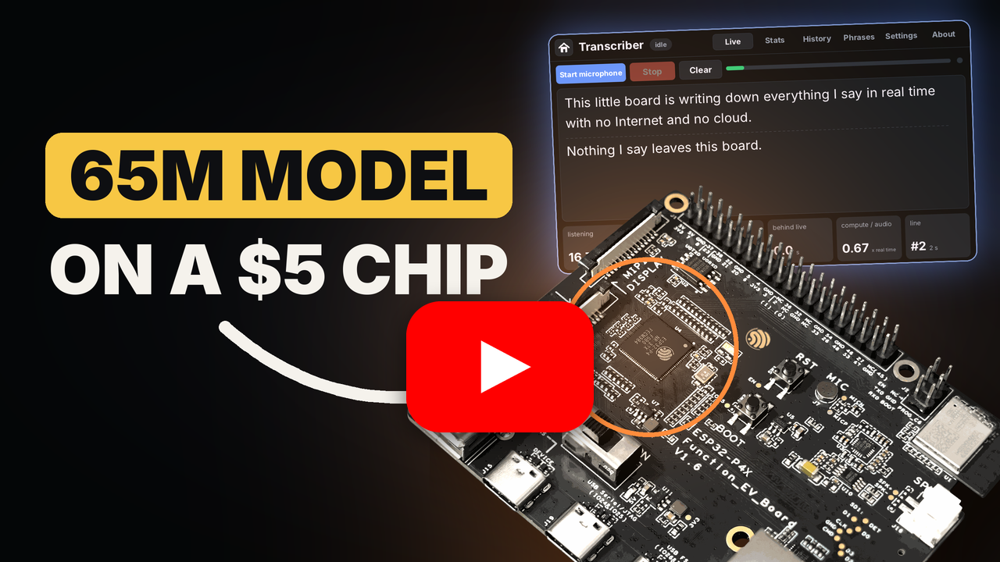

# esp32-pie-asr

[](https://boumedinebillal.github.io/esp32-pie-asr/)
[](https://github.com/BoumedineBillal/esp32-pie-asr/releases/latest)
[](https://github.com/BoumedineBillal/esp32-pie-asr/actions/workflows/firmware.yml)
[](https://huggingface.co/BoumedineBillal/esp32-pie-asr-kroko-en)

**Live English speech recognition on the ESP32-P4.** Open vocabulary, streaming, faster than real time, on the
microcontroller alone: the board's microphone in, the words on its screen as you speak. No cloud, no neural
accelerator; the two RISC-V cores and their PIE SIMD instructions.

The model is [Kroko](https://huggingface.co/Banafo/Kroko-ASR) (Banafo), a 65.7M-parameter streaming Zipformer2
transducer, with its weights brought from 71 MB to 26.65 MB in 2 and 4 bits. The weights are on Hugging Face:
[BoumedineBillal/esp32-pie-asr-kroko-en](https://huggingface.co/BoumedineBillal/esp32-pie-asr-kroko-en).

<p align="left">
  &nbsp;&nbsp;&nbsp;&nbsp;<a href="https://www.youtube.com/watch?v=oe-2MowdsSs&t=7s"></a>
</p>

| | |
|---|---|
| Accuracy | LibriSpeech test-clean **4.34 %** WER, test-other **10.26 %** (beam search, 4 hypotheses) |
| Speed | **0.70× real time**: each 1.28 s of audio in 0.90 s, both cores at 400 MHz |
| Delay | a word is final about **2 s** after it is spoken (median 1.9 to 2.3 s, 95 % within 4.1 s) |
| Weights | **26.65 MB**, read from a microSD card at boot in 2.9 s |
| Memory | weights and state in the 32 MB PSRAM; 121 KB of internal RAM left free (104 KB with the demos) |
| Bit-exact | the chip computes exactly what the engine's PC build computes: the PC's WERs are the chip's |
| Phrases | words and sentences to listen for (hotwords), switched on the screen, no retraining |
| Voice control | six demos driven by spoken orders through word rules, no language model |

The firmware, [`firmwares/voice_control`](firmwares/voice_control), opens on live transcription, then the
voice-control demos. The transcriber's numbers were measured with
[`firmwares/live_transcriber`](firmwares/live_transcriber), the transcriber alone on the same engine, where the
engine's board tests are.

## Compared

| | Parameters | Weights | Runs on | Streaming | test-clean | test-other | Speed |
|---|---|---|---|---|---|---|---|
| **esp32-pie-asr** | 65.7M | **2/4-bit, 26.65 MB** | **ESP32-P4** (2 × 400 MHz RISC-V) | yes | **4.34 %** | **10.26 %** | **0.70× real time** |
| Kroko as released ([sherpa-onnx](https://github.com/k2-fsa/sherpa-onnx)) | 65.7M | int8, 71 MB | PC | yes | 3.94 % | 9.17 % | |
| [Oído](https://arxiv.org/abs/2610.13447), streaming, with LM | 13M | int8 | ESP32-S3 (240 MHz Xtensa) | yes | 4.86 % | 11.03 % | final text 4.1 to 11.1 s after clips of 3.6 to 10.6 s |
| [Oído](https://arxiv.org/abs/2610.13447), whole utterance | 13M | int8 | ESP32-S3 | no | 3.70 % | 8.23 % | 1.97× real time (one core) |
| [Moonshine Tiny](https://arxiv.org/abs/2410.15608) | 27.1M | float | CPU | no | 4.52 % | 11.71 % | |
| [Whisper tiny.en](https://arxiv.org/abs/2410.15608) | 37.8M | float | CPU | no | 5.66 % | 15.45 % | |
| [ESP-SR MultiNet](https://docs.espressif.com/projects/esp-sr/en/latest/esp32s3/speech_command_recognition/README.html) | | | ESP32-S3 | | a fixed list of up to 200 commands, not open vocabulary | | |

esp32-pie-asr and Kroko as released: measured here on all 2620 / 2939 clips with Whisper's English text normalizer
(Kroko with sherpa-onnx 1.13.8, the same beam width, 2 s of silence after each clip so its last chunk is decoded).
The others: as their authors publish them.

Where the accuracy goes, test-clean:

| | greedy | beam 4 |
|---|---|---|
| Kroko as released, int8 ONNX | 4.03 % | 3.94 % |
| 2/4-bit weights, float activations (PyTorch simulation) | 4.53 % | |
| 2/4-bit weights, integer activations: **the chip** | **4.52 %** | **4.34 %** |

The 2/4-bit weights cost about half a point; the integer arithmetic on the chip costs nothing.

## Phrases

A text file on the SD card lists words and sentences to listen for; a word the model spells differently gets its
spoken forms (`ESP32 = ESP thirty two`). Each one is switched on or off on the screen. On 140 text-to-speech clips
(35 sentences, 4 voices) with the default list:

| | the list's words found | its sentences found | false alarms (40 clips without them) | WER |
|---|---|---|---|---|
| phrases off | 0 of 60 | 62 of 72 | 0 | 19.5 % |
| **phrases on** | **46 of 60** | **70 of 72** | **0** | **3.4 %** |

## Voice control

The firmware's second page has six demos in which spoken orders drive a device simulated on the screen: a robot
vacuum, a smart home, a car cabin, a factory line, a kitchen, a presenter. No language model: each demo is a table
of word rules (an order's verb, then its target; numbers, rooms, "not the bedroom"), and the screen shows which
words fired each action. Each demo has its own phrase list.

On 188 text-to-speech clips per demo (25 orders and 22 near misses, ordinary sentences with the demo's words, 4
voices):

| | orders exact, no list | with its list | false actions (88 near misses) |
|---|---|---|---|
| robot vacuum | 92 % | 96 % | 0 |
| smart home | 93 % | 97 % | 0 |
| car cabin | 93 % | 97 % | 0 |
| factory line | 86 % | 94 % | 0 |
| kitchen | 97 % | 98 % | 0 |
| presenter | 97 % | 99 % | 0 |

The lists were chosen on these clips; every miss is a word heard wrong. The board gives the PC's actions on every
clip. From the end of an order to its action: median 1.84 s on the vacuum's page, 1.97 s on the factory's, at most
2.57 s. With a demo's page drawing, the engine stays under real time (at most 0.81×).

## Run it

Hardware: an ESP32-P4 of chip revision v3 (ESP32-P4X) with 32 MB PSRAM, a microphone, a screen, a microSD card.
Made and measured on Espressif's ESP32-P4X-Function-EV-Board (ES8311 microphone, 1024 × 600 MIPI-DSI panel).

The weights (26.65 MB) do not fit the board's 16 MB flash, so they live on a microSD card: at boot the firmware
reads them from the card into the 32 MB PSRAM (2.9 s) and runs from there.

1. Put the weights on a FAT-formatted microSD card, in its top folder:
   ```bash
   git clone https://github.com/BoumedineBillal/esp32-pie-asr
   cd esp32-pie-asr
   python models/download.py --card <the microSD card's folder>   # downloads, checks, copies
   ```
2. Put the card in the board's microSD slot.
3. Flash the firmware, from the browser (Chrome or Edge, no tools to install):
   **[boumedinebillal.github.io/esp32-pie-asr](https://boumedinebillal.github.io/esp32-pie-asr/)**, or with
   ESP-IDF v6.1:
   ```bash
   cd firmwares/voice_control
   idf.py set-target esp32p4
   idf.py -p PORT flash
   ```

At the first boot the firmware also writes its phrase lists on the card: `phrases.txt` for the transcriber and one
per demo (`vacuum_phrases.txt`, `smarthome_phrases.txt`, ...). To change a list, edit its file on a PC: one word or
sentence per line, `shown = spoken | spoken` for a word the model spells differently, `#` for a note; the screen
shows up to 10 words and 10 sentences.

`firmwares/live_transcriber` (the transcriber alone) builds and flashes the same way.

The debug build adds a link to a PC over the board's USB High-Speed port (commands, the log, the words,
screenshots) for the board tests (`debug/tests/run_all.py`, Windows):

```bash
idf.py -B build_debug -D SDKCONFIG=build_debug/sdkconfig \
       -D SDKCONFIG_DEFAULTS="sdkconfig.defaults;sdkconfig.debug" -p PORT flash
```

## Inside

How the model fits and runs, in [docs/design.md](docs/design.md):

- **2/4-bit weights** in groups of 128, with a Hadamard rotation and one norm per group; 2 or 4 bits chosen per
  matrix by its sensitivity, without training.
- **Integer arithmetic**: int8 into the products, int16 between them, int8 attention caches, activations by table.
- **PIE SIMD kernels** written in assembly, each with a C reference that the host build runs; the products split
  over both cores.
- **Bit-exact with the PC**: deterministic math on both sides, checked on every test clip (the encoder's output CRC
  and the text) and on every kernel.
- **Streaming** in 1.28 s chunks with fixed-size caches; a beam search with phrase biasing; the transcript's word and
  line rules.
- **Voice control** by word rules, tested on the PC; on its pages a pause commits the search's best hypothesis, so
  an order acts about 1.9 s after its end instead of 3.1 s.

| Folder | |
|---|---|
| [`pieasr/`](pieasr) | the engine: an ESP-IDF component, its host build (`host/`), its tests (`tests/`) |
| [`components/`](components) | the speech service, the voice rules, the microphone, the screen and touch, the SD card, the debug link |
| [`firmwares/voice_control/`](firmwares/voice_control) | the firmware: live transcription and the six demos, their clip tests on the board and the PC |
| [`firmwares/live_transcriber/`](firmwares/live_transcriber) | the transcriber alone, with the engine's board tests |
| [`models/`](models) | the weights' download |
| [`tools/eval/`](tools/eval), [`benchmarks/`](benchmarks) | the WER measurements and every text they scored |

## Reproduce

```bash
cmake -S pieasr/host -B build/host -DPIEASR_WEIGHTS=$PWD/models/kroko-en-q24-v1.bin
cmake --build build/host && ctest --test-dir build/host          # unit tests and the 8 golden clips
python tools/eval/get_librispeech.py --set test-clean            # 2620 clips; --set test-other: 2939
bash tools/eval/run_wer.sh data/test-clean int+beam4             # the chip's configuration, on the PC
bash pieasr/tests/target/run.sh                                  # every PIE kernel against its C reference, on the board
```

## Next

- Support for the ESP32-S31, which has the same PIE 2.2 SIMD instructions as the ESP32-P4X.
- Arabic: a model for Modern Standard Arabic.

## Credits

- [Kroko](https://huggingface.co/Banafo/Kroko-ASR) by Banafo: the model (community license, CC-BY-SA).
- [Cactus Quants](https://docs.cactuscompute.com/latest/docs/cactus_quants/) by Cactus Compute: the weight format
  (Hadamard-rotated groups of 128, Lloyd-Max levels).
- [LibriSpeech](https://www.openslr.org/12) (CC BY 4.0): the 8 test clips in `pieasr/tests/data` and the WER sets.
- [Piper](https://github.com/rhasspy/piper) and its voices: the text-to-speech test clips (made by the tests'
  scripts, not in the repo).
- Espressif: ESP-IDF, and the ES8311 and EK79007 register values (Apache-2.0).
- [Inter](https://rsms.me/inter/) (SIL OFL 1.1) and [stb_truetype](https://github.com/nothings/stb) (public domain or MIT).

## License

The code: Apache-2.0 ([LICENSE](LICENSE)). The weights: CC-BY-SA 4.0, as Kroko's.

## Author

**Boumedine Billal**: [GitHub](https://github.com/BoumedineBillal) ·
[Hugging Face](https://huggingface.co/BoumedineBillal) ·
[LinkedIn](https://www.linkedin.com/in/boumedine-billal-a9a850239/) ·
[boumedinebillal@gmail.com](mailto:boumedinebillal@gmail.com)

```bibtex
@misc{boumedine2026esp32pieasr,
  author = {Boumedine Billal},
  title  = {esp32-pie-asr: streaming speech recognition on the ESP32-P4},
  year   = {2026},
  url    = {https://github.com/BoumedineBillal/esp32-pie-asr}
}
```
